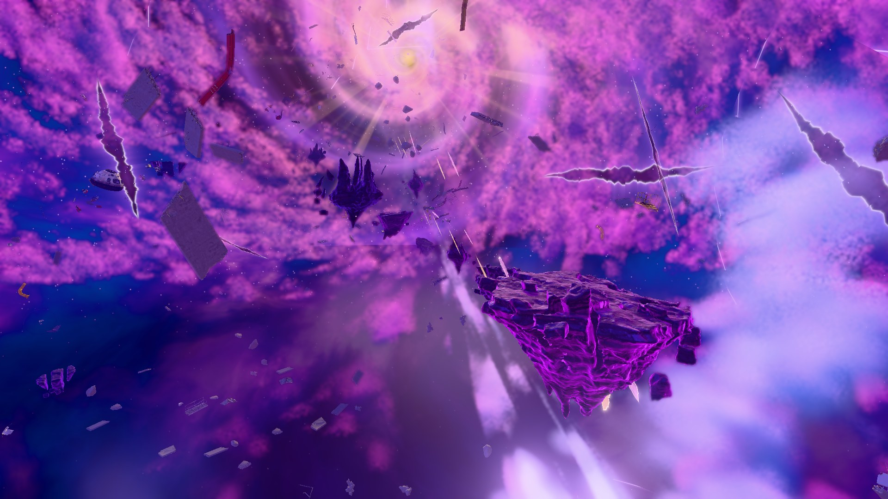
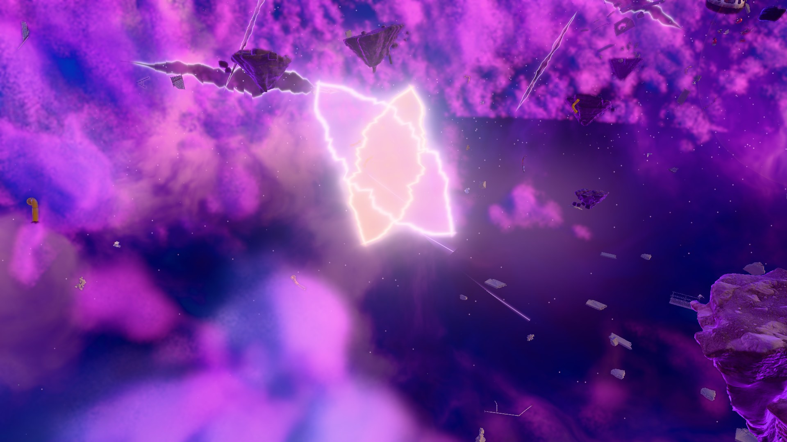
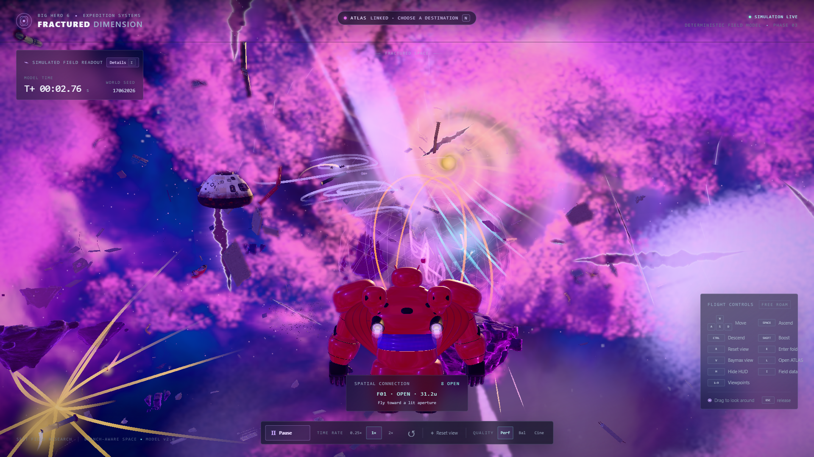
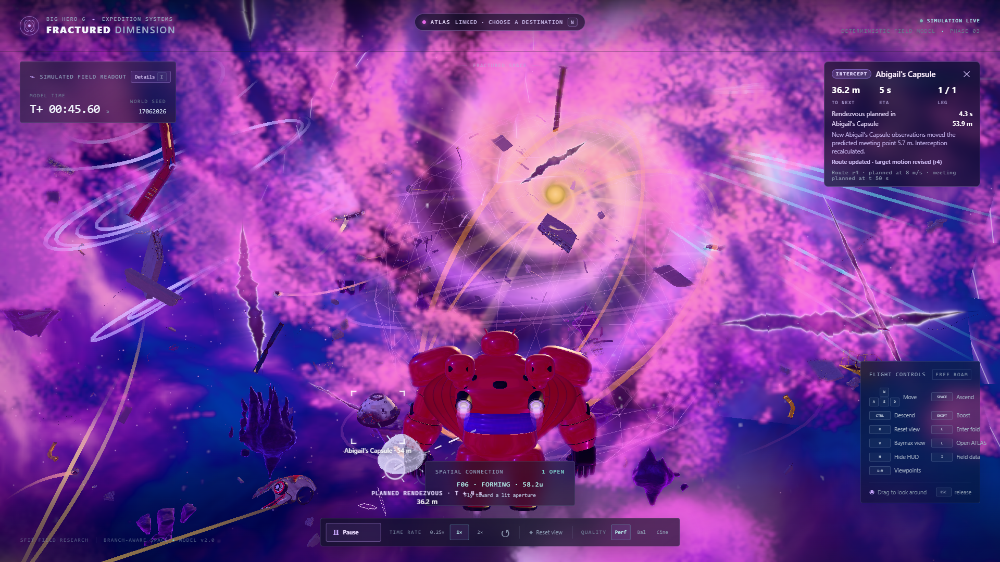

# Big Hero 6: Fractured — Dimension

**Companion app: [ATLAS Command](https://github.com/Aadit-issar/big-hero-6-fractured-atlas)** · **[Judge guide](docs/JUDGE_GUIDE.md)**

An equation-governed, browser-based fictional dimension inspired by the *Big Hero 6* portal realm. Fourteen floating islands drift through a gaseous violet-cobalt void around a golden vortex, among concrete, steel, capsule and armour wreckage. Everything that moves is driven by one seeded nonlinear scalar field, and the temporary **folds** you can fly into are real consequences of that mathematics. You fly Baymax through it in real time.

| | |
|---|---|
|  |  |
|  |  |

## Role in Big Hero 6: Fractured

The project has two applications:

| | Dimension (this repo) | ATLAS Command ([repo](https://github.com/Aadit-issar/big-hero-6-fractured-atlas)) |
|---|---|---|
| Role | The world and the truth: field, folds, moving objects, Baymax's flight, sensors | Baymax's intelligence: remembers observations, predicts, plans, interprets |
| Port | `4183` | `5184` |

The Dimension runs standalone. Together they form a closed loop: the Dimension reports Baymax's position, clock and sensor scans to ATLAS; ATLAS remembers them, forecasts where moving objects will be, plans a route or an interception, and sends it back; the Dimension draws the route in 3D and decides, from true positions, whether Baymax arrived.

## System requirements

- **Node.js 20.19+ or 22.12+** (Node 24 was used in development) and the **npm** that ships with it. No other package manager is needed; the lockfile is `package-lock.json`.
- A desktop browser with **WebGL2**: current **Chrome or Edge** (the browsers used in development). Keyboard and mouse are required.
- A discrete or recent integrated GPU. The scene is raymarched; on weak GPUs add `?quality=performance` to the URL.
- No other software, accounts, API keys or environment variables.
- Instructions below are for Windows PowerShell; the npm commands are the same elsewhere.

## Install

```powershell
git clone https://github.com/Aadit-issar/big-hero-6-fractured-dimension.git
cd big-hero-6-fractured-dimension
npm ci
```

## Run

**Standalone** (just the Dimension):

```powershell
npm start          # development server, http://127.0.0.1:4183/
# or
npm run serve      # production build, then http://127.0.0.1:4183/ (smoother)
```

Open `http://127.0.0.1:4183/` in Chrome or Edge. First load generates island terrain in web workers (a few seconds). Stop with **Ctrl+C**.

**With ATLAS (live demonstration):** run the Dimension first, then ATLAS.

```powershell
# one-command launcher: clone ATLAS next to this folder, then run its launcher
git clone https://github.com/Aadit-issar/big-hero-6-fractured-atlas.git ..\big-hero-6-fractured-atlas
cd ..\big-hero-6-fractured-atlas
powershell -ExecutionPolicy Bypass -File scripts\start-live-demo.ps1
```

Or manually, in two PowerShell windows: `npm run serve` in each repository. Then open
`http://127.0.0.1:4183/?quality=cinematic&view=baymax&atlas=http://127.0.0.1:5184/` and press **L** to open ATLAS linked to that Dimension. Full walkthrough: **[docs/JUDGE_GUIDE.md](docs/JUDGE_GUIDE.md)**.

URL options: `?quality=performance|balanced|cinematic` (default `cinematic`), `?view=first` (default is Baymax view), `?hud=0`, `?atlas=<ATLAS url>` (what **L** opens; default `http://127.0.0.1:5184/?experience=command`).

## Controls

| Input | Action |
|---|---|
| W / A / S / D | Move forward / left / back / right |
| Space / Ctrl | Ascend / descend |
| Shift | Boost (3x) |
| Click and drag | Look around (no pointer lock); Esc releases the drag |
| V | Toggle between Baymax view (default; camera trails Baymax) and first person |
| E | Enter a nearby open **fold** (prompt appears within 5 units) |
| R | Return to the opening view |
| L | Open ATLAS linked to this Dimension |
| T | Toggle ATLAS scan tags |
| N | Open the in-game ATLAS advisor panel |
| H or 2 | Hide/show the HUD |
| 1 | Hide/show Baymax |
| Alt+1…9 | Rendering-only viewpoints; Shift+1…9 frame the physical objects |
| I | HUD details |

The dock provides pause, 0.25x/1x/2x time, simulation reset and the Perf/Bal/Cine quality selector (rendering only; physics never changes).

### Folds

Cyan/violet apertures mark the two endpoints of an open connection; amber = unstable, orange = closing; closed folds cannot be entered. Fly toward one and press **E** within five units to traverse it. This changes the real reference branch and places you at a checked exit; a cooldown (1.5 model seconds) prevents repeated entry. Eight selected anchor regions are monitored, not every possible fold.

### ATLAS interaction in the Dimension

- **Scanning** (requested from ATLAS) fires a sonar pulse and tags what was observed.
- A sent route appears as a **dashed 3D line** with waypoint markers, distances and an arrival ring, a rendezvous reticle, and a translucent projection of the capsule at its predicted meeting position. Close in, the HUD switches to a precision reticle.
- The Dimension itself decides arrival (within the capture radius of the true target) or miss.

## Connection to ATLAS

- Transport is browser `window.postMessage` between two windows: **no relay server and no WebSocket**. Origins must be loopback (`127.0.0.1` / `localhost`).
- **One window must open the other**: press **L** here, or use ATLAS's "Open Dimension and connect". Independently opened tabs cannot find each other.
- Both app servers (ports 4183 and 5184) and both windows must stay open.
- **Dimension → ATLAS** at 4 Hz: Baymax's pose, velocity, attitude, the simulation clock, sensor observations (islands and folds within 60 m), and proximity scans (objects with labels and attitudes, never their velocities, parameters or future positions). The Dimension never sends its object registry or ground truth; an object appears in ATLAS only when scanned.
- **ATLAS → Dimension**: scan requests and routes (validated: bounded coordinates, at most 24 waypoints, strictly increasing revision, correct session). A route is display data; it can never move Baymax or change the simulation.
- **Route acknowledgements and navigation reports** return to ATLAS.
- Details: [docs/ATLAS_BRIDGE.md](docs/ATLAS_BRIDGE.md), [docs/ATLAS_LIVE_FINAL_ARCHITECTURE.md](docs/ATLAS_LIVE_FINAL_ARCHITECTURE.md).

## Technical explanation

**Mathematical basis.** A seeded nonlinear scalar field Φ(q,t) (four travelling waves plus pairwise interaction terms; seed `17062026`, model `fractured-2.0`) defines a spatial map `X(q,t) = L·(q + α∇Φ(q,t))` from reference space q to world space (`L = 7.5`, `α = 4`). Its gradient, Hessian and temporal derivative give the Jacobian of the map; the eigenvalues of that symmetric Jacobian locate **compressed mapping folds**, and the same field provides gravity, hazard and instability samples. A bounded damped least-squares inverse tracks the explorer's reference coordinates and reports explicit uncertainty near caustics. Simulation code is deterministic and independent of React/Three.js; state is a pure function of the clock, so reset and replay are exact. This is computational mathematics for a fictional universe, not a physical theory.

**Dynamic object movement.** Movers (Abigail's capsule, armour pieces, a girder and seven more with different mass and drag) obey, in reference space,

`q̈ = −k(q − g(t)) − c·q̇ − μ∇Φ(q,t) + a_d(q,t)`,

and are then mapped through the unchanged `X`. `g(t)` is a closed guide lane (ellipse, figure-eight or trefoil), `−μ∇Φ` is a force from the same field that defines the map, and `a_d` are localised "dimensional disturbances" (swirl, fracture sheet, breathing well). Fold-coupled movers are drawn into and thrown out of real fold endpoints from the live connection graph. Integration is symplectic Euler at 1/60 s. See [docs/DIMENSION_DYNAMICS_OVERHAUL.md](docs/DIMENSION_DYNAMICS_OVERHAUL.md) and [docs/MATHEMATICAL_MODEL.md](docs/MATHEMATICAL_MODEL.md).

**Fold behaviour.** Folds are sampled connections with a lifecycle (open, unstable, closing, closed) evaluated on a quarter-second lattice with a one-second sampled safety horizon. Entry is an explicit branch selection, never a hidden global inverse.

**Architecture.** `src/simulation/` (pure maths), `src/world/` (movers, disturbances), `src/scene/` (React Three Fiber / Three.js rendering: terrain from seeded signed-distance fields meshed with surface nets in workers, raymarched gas, vortex, mirror panes, wreckage, route overlay), `src/baymax/` (Baymax model), `src/bridge/` (ATLAS link, navigation), `src/ui/` (HUD), `src/shared/` (wire contract), `tests/` and `e2e/` (Vitest / Playwright). More: [docs/ARCHITECTURE.md](docs/ARCHITECTURE.md). Stack: React 19, TypeScript, Vite, Three.js, React Three Fiber.

Developer commands: `npm run typecheck`, `npm test`, `npm run build`.

## Troubleshooting

| Problem | Fix |
|---|---|
| `node`/`npm` not found, or errors about the Node version | Install Node 20.19+ or 22.12+ and reopen PowerShell. Check `node -v`. |
| Missing dependencies / `Cannot find module` | Run `npm ci` in the repository root. |
| `Port 4183 is already in use` | An earlier server holds the port. Close that PowerShell window, or find the owner with `Get-NetTCPConnection -LocalPort 4183`. The ports are fixed because ATLAS defaults to them. |
| Blank/black scene or WebGL error | Use current Chrome/Edge, enable hardware acceleration, update GPU drivers, try `?quality=performance`, check `chrome://gpu` for WebGL2. |
| Models or textures missing (grey rocks, no wreckage) | Wait for the loading veil to finish; confirm `public/assets/` exists and that you opened the served URL, not `index.html` from disk. |
| ATLAS shows "Connect to the running Dimension" / no observations | Press **L** in the Dimension (or use ATLAS's connect button); allow pop-ups for `127.0.0.1`; use `127.0.0.1`, not `localhost`, in both; keep both servers and windows open; first connection can take 10–20 s while terrain generates. |
| ATLAS lost its records | Reloading the Dimension starts a new session; ATLAS treats it as a new episode by design. |
| Route does not appear in the Dimension | Send it from **Route planning** while connected (not "LINK LOST"); check the Dimension HUD is visible (**H**) and both windows belong to the same session. |

## Third-party notices

- Surface textures: Poly Haven CC0 1.0 sets (Cliff Side, Rocks Ground 06, Lichen Rock, Concrete Wall 007, Concrete Debris, Rust Coarse 01); see [docs/ASSET_PROVENANCE.md](docs/ASSET_PROVENANCE.md).
- Models and procedural textures were generated for this project with the generators in `assets-src/`; some shapes were guided by AI-generated concept sheets.
- *Big Hero 6*, Baymax, Hiro and related names and characters belong to Disney. This is an independent, non-commercial fan project made for a competition; it is not affiliated with or endorsed by Disney. No licence is granted over those properties, and no open-source licence has been applied to this repository.
- Open-source dependencies keep their own licences (see `package-lock.json`).

## Start-up notice

On first launch a small, dismissible card reminds you that the Dimension and ATLAS Command are meant to be installed together from GitHub. **Got it** hides it for this visit, **Don't show again** remembers the choice in the browser, and `?pairNotice=0` suppresses it (useful for automated tests). It never blocks flight or any other control.
