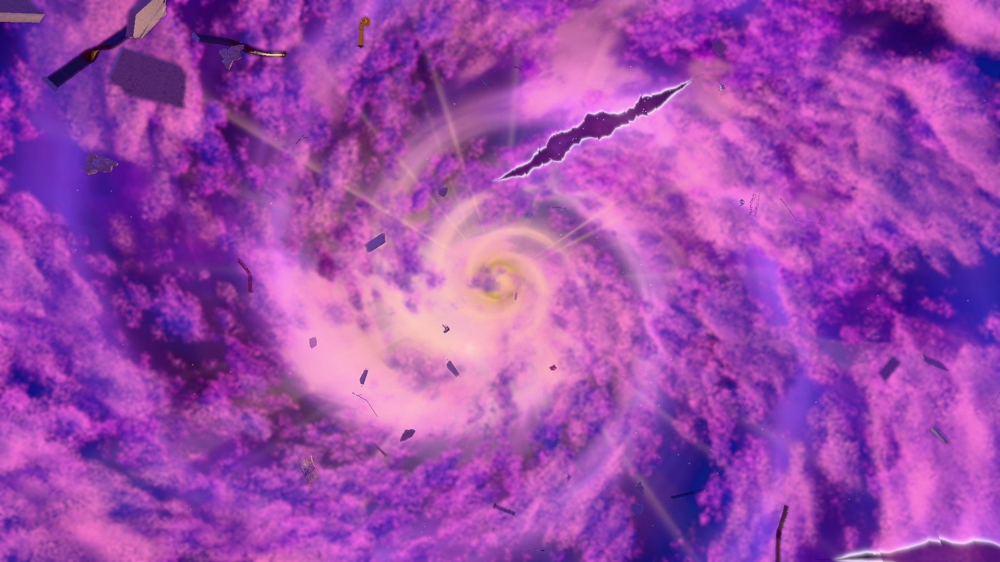
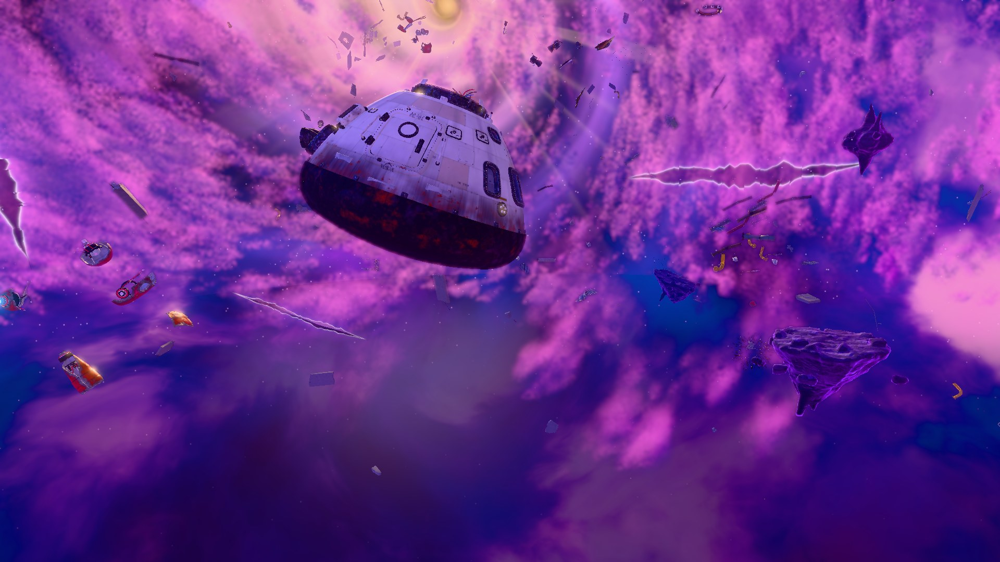

# Big Hero 6: Fractured Dimension

**[▶ Play Online — explore the live Dimension (Chrome or Edge, desktop)](https://aadit-issar.github.io/big-hero-6-fractured-dimension/)** — nothing to install. Add `?quality=performance` for smoother frame rates on integrated GPUs.

A browser-based, equation-governed fictional dimension inspired by the *Big Hero 6* portal realm. Fourteen floating islands drift through a gaseous violet–cobalt void around a golden vortex, among concrete, steel, capsule and armor wreckage. Everything that moves is driven by one seeded nonlinear scalar field, and the temporary "folds" you can fly into are real consequences of that mathematics.

| | |
|---|---|
|  |  |
|  |  |

## Features (standalone — no other app needed)

- Free-flight exploration of the Dimension with raymarched, sky-like gas clouds, a golden vortex, mirror panes and procedural island geology generated at load time in Web Workers.
- Eight real **folds** (temporary connections) with open / unstable / closing lifecycle; press **E** beside one to traverse it and change the reference branch.
- Gravity-probe debris, hazard volumes and a live scientific HUD (reference coordinates, inverse residual, stretch, gravity, risk).
- Placed wreckage assets (concrete, industrial steel, capsule remnant, armor shells) with LODs.
- Deterministic simulation (seed `17062026`, model `fractured-2.0`), pause/speed controls, rendering quality presets (rendering only; physics never changes).

## Mathematical foundation

```
Φ(q,t) = Σᵢ Aᵢ sin(uᵢ) + λ Σᵢ<ⱼ AᵢAⱼ sin(uᵢ) sin(uⱼ),   uᵢ = kᵢ·q − ωᵢt + θᵢ
X(q,t) = L [ q + α ∇Φ(q,t) ]            (L = 7.5, α = 4)
J = I + α HΦ ,   det(DX/Dq) = L³ det J
```

`q` is a reference space, `X` the rendered space. Where an eigenvalue of `J` collapses (strong compression) the map folds; sampled fold regions become fictional temporary connections. This is computational mathematics for a fictional universe, not a validated physical theory. Full derivation, analytic gradient/Hessian and verification: [docs/MATHEMATICAL_MODEL.md](docs/MATHEMATICAL_MODEL.md), [docs/ARCHITECTURE.md](docs/ARCHITECTURE.md).

## Controls

| Input | Action |
|---|---|
| Drag (left mouse) | Look around (Esc releases) |
| W A S D | Fly |
| Space / Ctrl | Ascend / descend |
| Shift | Boost |
| E | Traverse the fold you are next to (a prompt appears) |
| R | Reset view to the opening pose |
| 1–9 | Camera viewpoints (overview, geology, fracture corridor, mirror chamber, vortex, turbulent wide, fracture region, spire, rift) |
| Shift + 1–9 | Object views (microbot swarm, formation, debris cluster, beams, landmark, fold shear, strain shear, vortex inflow, material) |
| H | Hide / show HUD |
| P | Pause / resume simulation |
| I | Expand / collapse field readout |
| On-screen dock | Pause / resume, 0.25× / 1× / 2× time rate, reset simulation, reset camera, Perf / Bal / Cine rendering quality |

Loading takes roughly 10–15 s while terrain is generated; the veil lifts when the scene is ready. Suggested route: [docs/DIMENSION_FINAL_DEMO.md](docs/DIMENSION_FINAL_DEMO.md).

URL options: `?quality=performance|balanced|cinematic`, `?hud=0`, `?clouds=legacy`.

The GitHub Pages build starts new visits at **Cinematic** quality. An explicit `?quality=` option or a quality choice already saved in the browser takes precedence; use `?quality=performance` on slower GPUs.

## Run locally

Requirements: Node.js 20.19+ or 22.12+ (tested on 24), npm, and a desktop browser with WebGL2 (Chrome or Edge recommended). A discrete or modern integrated GPU is advised.

```bash
git clone https://github.com/Aadit-issar/big-hero-6-fractured-dimension.git
cd big-hero-6-fractured-dimension
npm ci
npm run dev
```

Open **http://localhost:5173/**. On Windows you can instead double-click `start-windows.bat` (installs if needed, starts the server and opens the browser).

Other commands: `npm run typecheck`, `npm test` (106 unit tests), `npm run build`, `npm run preview`, `npm run test:e2e` (Playwright, needs Chrome).

## Standalone vs. ATLAS

Everything above runs without ATLAS. **ATLAS** is a separate application (not included in this repository) that can connect to a running Dimension through a read-only, origin-validated browser message bridge ([docs/ATLAS_BRIDGE.md](docs/ATLAS_BRIDGE.md)). Only these features need it: the **L** key (opens ATLAS), the ATLAS advisor pill/panel (**N**) and advisory destination requests. Without ATLAS running, these simply stay idle; nothing else is affected. The bridge cannot change simulation state.

## Limitations

- Desktop keyboard + mouse only; no touch/mobile support.
- First load is heavy (~125 MB of models and textures) and generates terrain on the fly.
- Frame rate depends on the GPU (integrated GPUs: use `?quality=performance`).
- Fold detection covers eight anchor regions, not every fold in continuous space; flight has no collisions.

## Credits and licensing

Source code and original assets: © the project authors. Textures are CC0 from [Poly Haven](https://polyhaven.com); see [docs/ASSET_PROVENANCE.md](docs/ASSET_PROVENANCE.md). This is an unofficial fan/educational project inspired by Disney's *Big Hero 6*; it contains no film footage, stills, or official assets, and is not affiliated with or endorsed by Disney.
